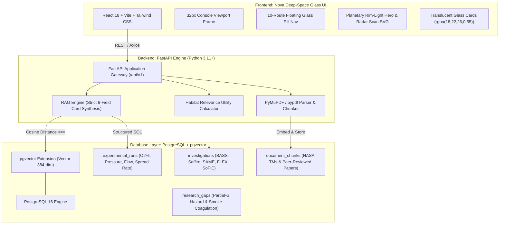

# NASA FireSafe AI & SpaceFire Decision Platform (SAFIR)
### Microgravity & Partial-Gravity Combustion Intelligence Platform
*Official Submission for the 2026 NASA Space Apps Challenge ("Flame in Freefall: SI-Powered Fire Safety Insights from Microgravity Combustion")*

[](http://localhost:5173/safir)
[](#scientific-data-integrity--no-fabrication-policy)
[](#ai--pgvector-rag-engine)
[](#nova-deep-space-glass-design-system)
[](#test-suites--verification)

**NASA FireSafe AI & SAFIR** is a production-grade full-stack research intelligence platform engineered for aerospace engineers, safety officers, and microgravity combustion scientists. Grounded strictly in authentic flight data from NASA's **Physical Sciences Informatics (PSI)** repository, the platform models material flammability, extinction limits, and smoke detection dynamics across **Microgravity (0g)**, **Lunar Partial Gravity (0.16g)**, **Martian Partial Gravity (0.38g)**, and **Terrestrial (1g)** baselines.

---

## 🌟 Flagship Single-Screen: SpaceFire Decision Platform (SAFIR)
Launch direct at: **`http://localhost:5173/safir`**

A 4-Quadrant Zero-Scroll Bento Grid inspired by SpaceX Crew Dragon mission controls and NASA Combustion Integrated Rack (CIR) optical diagnostics:
1. **Top Telemetry Bar:** 1-Click environment presets (`ISS Baseline`, `Artemis Lunar Habitat`, `Lunar EVA Spacesuit`, `Mars Surface Habitat`, `Earth Ground Lab`).
2. **Q1 // Habitat Telemetry & Material Inputs:** Fine-grained physical sliders ($O_2\%$, $P_{\text{psi}}$, $g$, $u_{\text{forced}}$) and real-time computation of $p_{O_2}$, $u_{\text{buoyant}}$, $u_{\text{eff}}$, and $G^*$ (Grashof proxy).
3. **Q2 // CIR Optical Chamber & Flame Morphology:** Interactive real-time physics-driven flame viewport simulating $0g$ soot-free blue spherical flames, $0.165g$ lunar sluggish elongated flames, and $1g$ turbulent sooty buoyant flames.
4. **Q3 // SI Decision Engine & Risk Assessment:** Composite Fire Safety Index (CFSI) with color dynamics (`#10B981` Nominal, `#F59E0B` Amber, `#EF4444` Crimson Alert) and actionable flight directives.
5. **Q4 // NASA PSI Flight Evidence Grounding & Gap Detector:** Real-time matching to authenticated flight records (`Saffire`, `SoFIE`, `BASS`, `FLEX`, `SAME`) with striped caution borders for unmapped partial-g knowledge voids.

---

## 1. System Architecture



---

## 2. Core Scientific Missions & Seed Data

The platform seeds verifiable flight parameters for landmark microgravity investigations:

| Investigation | Facility / Carrier | Category | Regime | Key Documented Parameter |
| :--- | :--- | :--- | :--- | :--- |
| **BASS & BASS-II** | ISS Microgravity Science Glovebox | Suppression | 0g Microgravity | Quiescent LOI: 16.5% O2; PMMA spread: 0.08 mm/s |
| **Saffire-I** | Cygnus Resupply Vehicle | Prevention | 0g Microgravity | Large fabric (0.4m x 1.0m) spread rate: 1.85 mm/s |
| **Saffire-II & III** | Cygnus Resupply Vehicle | Prevention | 0g Microgravity | High flow (25 cm/s) SIBAL spread: 2.45 mm/s |
| **SAME & SAME-R** | ISS Microgravity Science Glovebox | Detection | 0g Microgravity | Supermicron smoke agglomeration: 1.5–2.5 µm |
| **DAFT & DAFT-2** | ISS Destiny Laboratory | Detection | 0g Microgravity | Baseline cabin aerosol shifts & P-Trak calibration |
| **FLEX & FLEX-2** | ISS Combustion Integrated Rack | Suppression | 0g Microgravity | Discovery of quasi-steady droplet "cool flames" |
| **ACME** | ISS Combustion Integrated Rack | Prevention | 0g Microgravity | Electric field steering of spherical diffusion flames |
| **SoFIE** | ISS Combustion Integrated Rack | Prevention | 0g Microgravity | Exploration Atmosphere (56.5 kPa, 34% O2): 0.38 mm/s |

### Scientific Data Integrity & "No Fabrication Policy"
In strict compliance with aerospace research standards:
- **No Estimated Numbers in Seed Records:** If an experimental run did not measure flame spread rate (e.g. for non-flammable Ultem or liquid droplets), the value is stored as SQL `NULL` and rendered as `<NotAvailableBadge />` (`"Not available"`).
- **Separation of Verified Data vs. Synthesis:** Verified NASA flight metrics carry a `#BFE3A8` status dot and `VERIFIED NASA PSI DATA` pill. AI extrapolations carry a dashed glass pill `AI-GENERATED ANALYSIS`.

---

## 3. "Nova Deep-Space Glass" Design System

- **Background Primary:** `#06080B` (near-black space, subtle radial vignette, starfield, 3% noise overlay).
- **Card Glass Surface:** `rgba(18, 22, 26, 0.55)` with `backdrop-filter: blur(20px)`.
- **Accent Color:** Soft Sage Green `#BFE3A8` used for headline emphasis (`ENDURE.`), verified status dots, radar blips, active chart highlights, and timeline indicators.
- **Buttons:** Solid white `#FFFFFF` with black text (`border-radius: 999px`) for primary actions; transparent with `1px solid rgba(255,255,255,0.2)` for secondary actions.
- **Console Shell:** A `32px` rounded viewport frame simulating a spacecraft flight console with an interactive scrub line drawer.

---

## 4. The 10 Application Modules

1. **Dashboard Overview (`/`)**: Hero section with planetary rim light, orbit paths, vertical stat rail, 5-card bottom grid, and atmospheric flammability overview chart.
2. **AI Research Assistant (`/assistant`)**: Source-grounded pgvector RAG chatbot outputting the **6-Part Scientific Card**:
   - `01 • SCIENTIFIC SYNTHESIS`
   - `02 • RELEVANT INVESTIGATION(S)`
   - `03 • EXPERIMENTAL CONDITIONS` ($O_2\%$, pressure, flow, material)
   - `04 • SOURCE DOCUMENT` (filename, page, citation, exact passage)
   - `05 • BOUNDARY CONDITIONS & LIMITATIONS`
   - `06 • MISSING INFORMATION & UNMAPPED PARAMETERS`
   - *Fallback Rule:* Sub-threshold queries automatically yield `"Insufficient verified NASA evidence..."`.
3. **Experiment Explorer (`/experiments`)**: Multi-facet filter by Category, Gravity Regime, Facility, Material, and Data Completeness. Multi-select experiments for comparison.
4. **Experiment Details (`/experiments/:code`)**: Deep dive with verified runs table, tabular figures, linked PDF chunks, and direct PSI links.
5. **Compare Experiments (`/compare`)**: Side-by-side comparison matrix for 2 to 4 missions with cross-scale combustion synthesis.
6. **Habitat Relevance Ranking (`/habitat-ranking`)**: Transparent utility formula with interactive `#BFE3A8` weight sliders recalculating live rankings for Artemis, Gateway, Mars, and ISS.
7. **Research Gap Detector (`/research-gaps`)**: Animated concentric-ring SVG radar scan highlighting the **Partial-Gravity Peak Hazard Zone** ($0.16g$ & $0.38g$).
8. **Scientific Data Visualizations (`/visualizations`)**:
   - Flammability envelope ($O_2\%$ vs. Pressure kPa).
   - Flame spread rate vs. forced flow velocity across gravity regimes.
   - Smoke particle size distribution (SAME microgravity vs. terrestrial).
9. **Earth Applications (`/earth-applications`)**: Maps microgravity combustion discoveries to HCCI engines, wildfire sensors, fire-retardant composites, and electric flame steering.
10. **Sources & PDF Ingestion (`/sources`)**: Drag-and-drop glass uploader parsing PDFs with PyMuPDF, generating vector embeddings, and updating the citation index.

---

## 5. Quickstart & Deployment

### Option A: Local Run (Out-of-the-Box)

#### 1. Backend Setup:
```powershell
# In root directory:
cd backend
python -m pip install -r requirements.txt
python -c "import sys; sys.path.append('.'); from app.ingestion.seed_data import seed_database; seed_database(force_reseed=True)"
python run.py
```
Backend will start on `http://localhost:8000` with Swagger docs at `http://localhost:8000/docs`.

#### 2. Frontend Setup:
```powershell
# In another terminal:
cd frontend
npm install
npm run dev
```
Frontend will be live at `http://localhost:5173`.

---

### Option B: Docker Compose (Full Stack + pgvector)

```powershell
docker-compose up --build
```
- PostgreSQL 16 with `pgvector`: `localhost:5432`
- FastAPI Backend: `http://localhost:8000`
- React Frontend: `http://localhost:5173`

---

## 6. Test Suites & Verification

Run the automated backend test suite:
```powershell
python -m pytest backend/app/tests/ -v
```
All 14 tests verify health, investigations, fleet statistics, comparisons, research gaps, radar telemetry, visualizations, habitat recalculation, and strict RAG 6-field output formatting with fallback verification.
